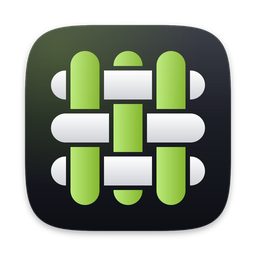
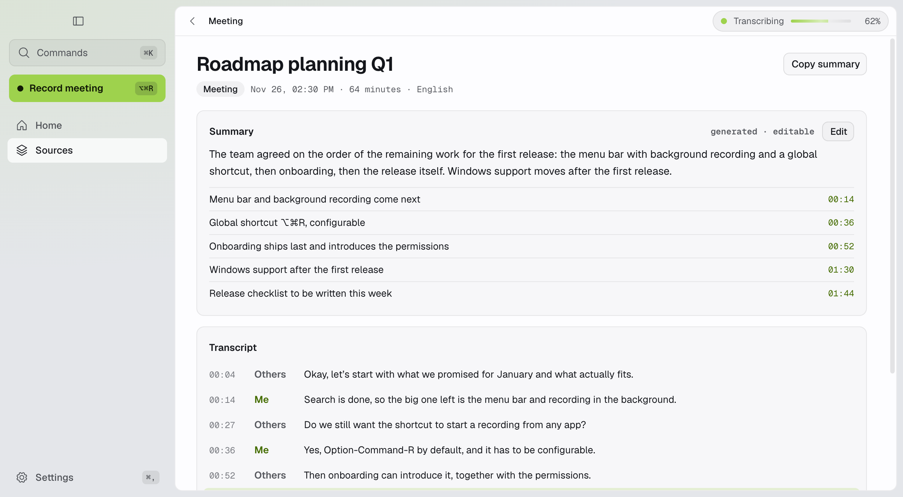
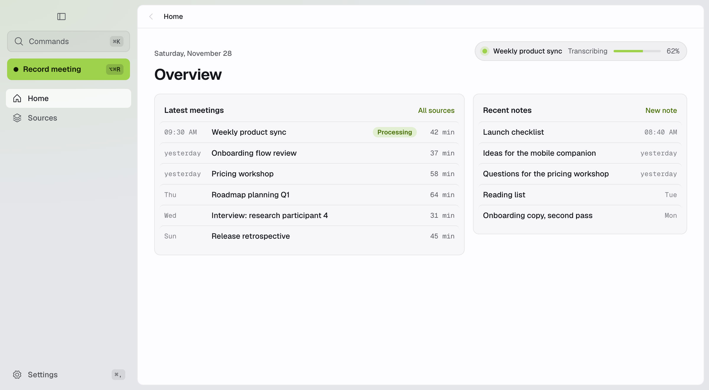
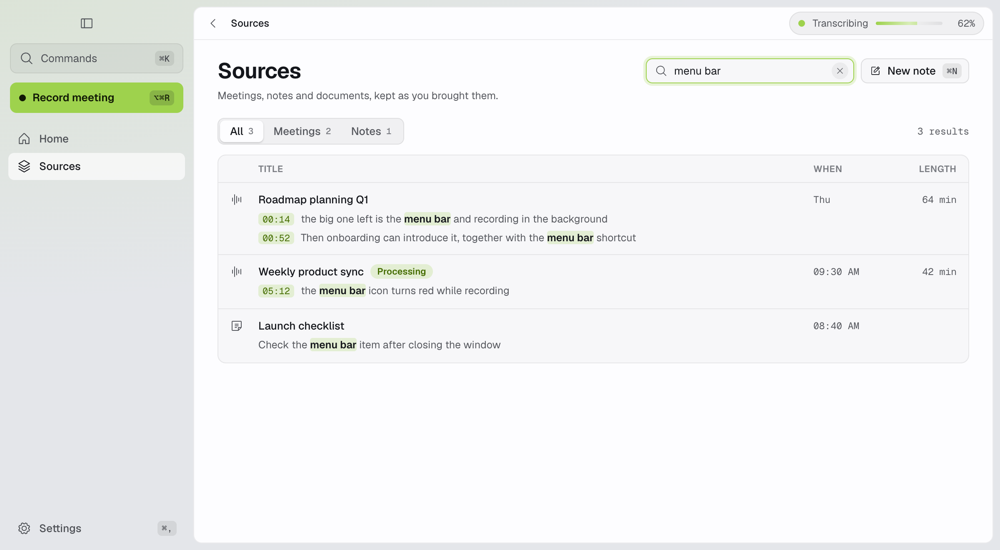

<p align="center">
  
</p>

<h1 align="center">Trama</h1>

<p align="center">
  <a href="https://github.com/lorenzotricaricoo/Trama/actions/workflows/ci.yml"></a>
  <a href="LICENSE"></a>
  
  <a href="https://github.com/lorenzotricaricoo/Trama/releases"></a>
  <a href="https://github.com/lorenzotricaricoo/Trama/releases"></a>
</p>

<p align="center">
  Record, transcribe and summarize your meetings, keep your notes,<br/>
  and find everything again: on your Mac, with your own AI provider.
</p>

<p align="center">
  <a href="https://github.com/lorenzotricaricoo/Trama/releases/latest">Download</a> &middot;
  <a href="#install">Install</a> &middot;
  <a href="CHANGELOG.md">Changelog</a> &middot;
  <a href="docs/vision.md">Vision</a> &middot;
  <a href="#documentation">Documentation</a>
</p>

<p align="center">
  <picture>
    <source media="(prefers-color-scheme: dark)" srcset="docs/assets/readme/meeting-dark.png" />
    
  </picture>
</p>

---

Trama records your meetings on two aligned tracks, your microphone and the other
participants, transcribes them **locally**, and writes a title and a summary with key
points you can jump to. Notes live next to the meetings, and one search finds a word
said in a call or written in a note. Phase 1 is out; it is the first step towards a
**second brain that organizes itself** ([vision](docs/vision.md)).

## Features

- **Meeting recording**: microphone and system audio on two aligned tracks, with a
  small recording window for the timer, the levels and notes taken during the call.
- **Local transcription**: both tracks become one timeline, in the background; the audio
  never leaves your Mac.
- **Summaries with your AI provider**: title, summary and key points tied to the moment
  they were said, editable. Any OpenAI-compatible provider, local servers included; keys
  stay in the macOS Keychain.
- **Search everything**: full-text search across transcripts, summaries and notes; a
  result opens the meeting at the minute something was said. ⌘K searches too.
- **Notes in Markdown**, saved as you type; import existing `.md` files by dropping them
  on the window.
- **Always at hand**: a menu bar item, a global shortcut (⌥⌘R) to start and stop a
  recording from any app, and recording that goes on with the window closed.
- **Yours to keep**: audio retention you choose, data in a folder on your Mac, an
  interface in English and Italian, light and dark, with the accent colour you like.

<table>
  <tr>
    <td width="50%">
      <picture>
        <source media="(prefers-color-scheme: dark)" srcset="docs/assets/readme/home-dark.png" />
        
      </picture>
      <p align="center"><sub>Home: latest meetings, recent notes and what is being processed</sub></p>
    </td>
    <td width="50%">
      <picture>
        <source media="(prefers-color-scheme: dark)" srcset="docs/assets/readme/search-dark.png" />
        
      </picture>
      <p align="center"><sub>Search: a phrase found in meetings and notes, with the minute it was said</sub></p>
    </td>
  </tr>
</table>

<sub>Screenshots with sample data.</sub>

## Platforms

| Platform | Status |
|----------|--------|
| macOS    | **0.1.0** — macOS 14.2 or later, Apple silicon |
| Windows  | Planned |

Dictation (speak and get text wherever you are writing) and turning audio files into
searchable text are planned after phase 1.

## Install

Trama is signed but not notarized by Apple
([ADR 0008](docs/adr/0008-distribution-without-notarization.md)), so macOS blocks the
downloaded `.dmg` the first time, and may block the app once more. Each block is lifted
the same way:

1. Download the `.dmg` from the [latest release](https://github.com/lorenzotricaricoo/Trama/releases).
2. Open it. macOS says it cannot verify the file: click **Done**, not *Move to Trash*.
3. Open **System Settings → Privacy & Security**, scroll to *Security*, click
   **Open Anyway** next to the message about the `.dmg` and confirm.
4. In the window that opens, drag **Trama** to **Applications**.
5. Open Trama. If macOS shows the same message for Trama, repeat step 3 for it.

If you trust the file you downloaded, you can instead remove the quarantine flag macOS
puts on downloads, so neither the `.dmg` nor the app is blocked:

```sh
xattr -d com.apple.quarantine ~/Downloads/Trama_<version>_aarch64.dmg
```

From then on Trama opens normally. On the first launch, a short setup asks for the
microphone and the system audio, downloads the transcription model (about 2.5 GB) and
adds an AI provider for the summaries; every step can be postponed and done later in
Settings.

Your data stays on your Mac, in
`~/Library/Application Support/io.github.lorenzotricaricoo.trama`.

To update, download the new `.dmg` the same way and replace Trama in Applications; your
data and settings stay.

## Development

### Requirements

- macOS with Xcode or the Command Line Tools
- [Rust](https://rustup.rs/): the version is pinned in `rust-toolchain.toml` and installed
  automatically by `rustup`
- [Node.js](https://nodejs.org/): the version is pinned in `.nvmrc` (`nvm use`)

### Layout

| Path | Content |
|------|---------|
| `crates/core` | Core library, independent of the UI |
| `apps/desktop` | Desktop app: React frontend (`src/`) and Tauri shell (`src-tauri/`) |
| `locales` | Interface text in [Fluent](https://projectfluent.org/), one folder per language |
| `docs` | Vision, principles, design and ADRs |

### Commands

From `apps/desktop`, after `npm ci`:

| Command | What it does |
|---------|--------------|
| `npm run tauri dev` | Runs the app with hot reload |
| `npm run bundle` | Builds `Trama.app` and the `.dmg`, signed, in `target/release/bundle` ([signing setup](docs/development/macos-signing.md)) |
| `npm test` | Frontend tests (Vitest) |
| `npm run lint` | ESLint, including the check for text not taken from `locales/` |
| `npm run typecheck` | TypeScript |
| `npm run format` | Prettier |

From the repository root:

| Command | What it does |
|---------|--------------|
| `cargo test --workspace` | Rust tests, including the check that every language has the same messages |
| `cargo clippy --workspace --all-targets -- -D warnings` | Rust lints |
| `cargo fmt --all` | Rust formatting |

The interface follows the system language (Italian or English, otherwise English). To
try another language, set `TRAMA_LOCALE`, for example `TRAMA_LOCALE=en npm run tauri dev`.

The app keeps its data in `~/Library/Application Support/io.github.lorenzotricaricoo.trama/Library`.
To keep development data apart, set `TRAMA_LIBRARY` to another folder, for example
`TRAMA_LIBRARY=/tmp/trama-dev npm run tauri dev`.
The transcription model (about 2.5 GB) is downloaded into `Models`, next to the library;
`TRAMA_MODELS` points development builds at another folder, so they can share one
download ([downloaded models](docs/architecture/models.md)).

The first Rust build downloads the prebuilt sherpa-onnx and ONNX Runtime libraries
(about 22 MB) used for transcription, and stops before linking if the archive or the
libraries extracted from it don't match the checksums pinned in `crates/core/build.rs` ([native libraries](docs/architecture/transcription.md#native-libraries)).
Tests that need the transcription model are ignored by default; see
[transcription tests](docs/architecture/transcription.md#tests) to run them.

## Documentation

- [Vision](docs/vision.md) — what Trama is, how it works, and the MVP scope
- [Information architecture](docs/design/information-architecture.md) — objects, screens, navigation and flows of the MVP
- [Visual direction](docs/design/visual-direction.md) — look, colours, type, motion and design tokens
- [Data model](docs/architecture/data-model.md) — how sources, meetings and notes are stored, versioned and searched
- [Audio capture](docs/architecture/audio-capture.md) — how a meeting is recorded on two aligned tracks ([manual checks](docs/development/audio-capture.md))
- [Downloaded models](docs/architecture/models.md) — the pinned transcription model, where it lives and how it is downloaded
- [AI providers](docs/architecture/providers.md) — providers, models per task and how calls stay robust
- [Transcription](docs/architecture/transcription.md) — the local engine, how both tracks become one timeline, the background job and its tests
- [Releasing](docs/development/releasing.md) — versions, how a release is built and published, manual checks
- [Principles](docs/principles.md) — rules for process and architecture
- [Architecture Decision Records](docs/adr/) — decisions and their reasons

## Security

To report a vulnerability, see [SECURITY.md](SECURITY.md).

## License

Released under the [MIT License](LICENSE). Third-party models, libraries and data, with
their licenses and attributions, are listed in [THIRD_PARTY_NOTICES.md](THIRD_PARTY_NOTICES.md).
