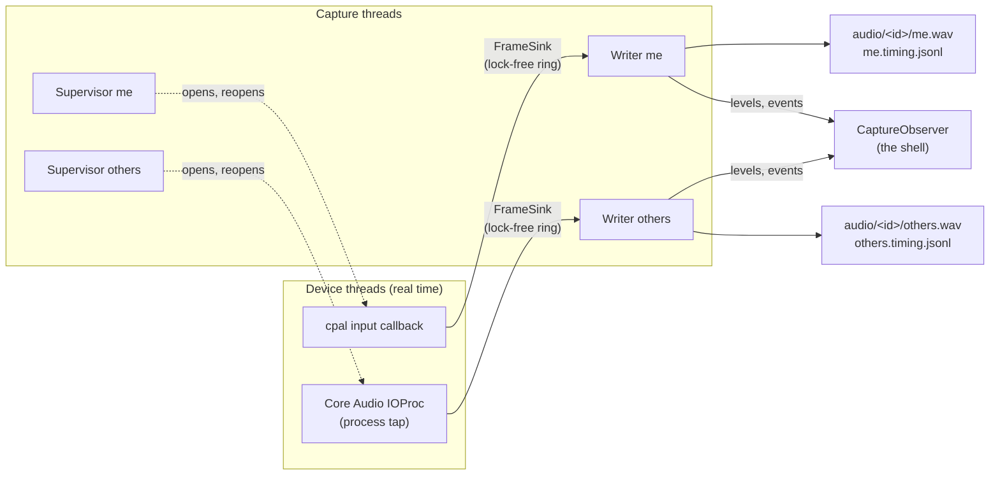

# Audio capture

How Trama records a meeting on two tracks: the user's microphone (`me`) and the system
audio of the other participants (`others`). The approach comes from spike
[#11](https://github.com/lorenzotricaricoo/Trama/issues/11); the code is in
`crates/core/src/capture/` ([#25](https://github.com/lorenzotricaricoo/Trama/issues/25)).
Manual checks on real devices: [audio capture checklist](../development/audio-capture.md).

## Overview

- **`CaptureBackend`** is the device side, a trait: the macOS implementation is
  `capture::macos::MacBackend`; tests use fake devices on a virtual clock. A Windows
  backend fits behind the same trait ([ADR 0005](../adr/0005-macos-first-windows-ready.md)).
- **The audio callback only copies** samples into a lock-free ring buffer (`rtrb`)
  through a `FrameSink`, with the host time of the first frame. It never blocks, locks or
  allocates.
- **One writer thread per track** drains the ring every 20 ms into the files, computes
  the levels and watches for problems.
- **One supervisor thread per track** opens the stream, and reopens it when the default
  device changes, when the stream reports an error, or when it stalls.
- **`Recording`** ties them together: `Recording::start` returns once both streams are
  open (or with the first error, leaving nothing behind); `register_tracks` adds the
  tracks to the library with `Library::add_track`; `stop` finishes the files and returns a
  summary. Dropping a `Recording` also stops it.

## macOS backend

| Track | Method | Permission |
|-------|--------|------------|
| `me` | `cpal` default input (or a chosen device), `f32` at the device rate; timestamps are the capture time on the host clock | Microphone (AVFoundation) |
| `others` | Core Audio **process tap** (`objc2-core-audio`): a stereo global tap that excludes Trama, in a private aggregate device clocked by the default output device, read by an IOProc | System Audio Recording |
| `others`, fallback | **ScreenCaptureKit** audio-only stream, used only when the tap cannot be created; cargo feature `screencapturekit`, off by default | Screen & System Audio Recording |

The app's minimum macOS (14.2) always has the process tap, so the fallback is for
unexpected failures only. It is off by default because the `screencapturekit` crate links
a Swift bridge (the binary needs `/usr/lib/swift` on its rpath) and because its permission
is broader and macOS asks to confirm it again periodically.

Both tracks are timestamped on the same clock, `mach_absolute_time` in nanoseconds.

## Files

For each track, under `audio/<meeting id>/` in the library:

- **`me.wav`, `others.wav`**: 32-bit float WAV, **mono** by default (the tracks are for
  speech; `RecordingOptions::channels` changes it), at the sample rate of the first
  device. A mono 48 kHz track stays under the 4 GiB WAV limit for six hours; a track that
  reaches it stops with `track_size_limit` while the other goes on.
- **`me.timing.jsonl`, `others.timing.jsonl`**: the timing sidecar (below).

Paths are registered relative to the library, as the data model requires. Existing files
are never overwritten (`already_recorded`).

### Crash safety

- Every 20 ms the writer appends the new audio to the WAV with a plain `write`: once
  written, it survives a crash of the process.
- Every second it patches the WAV header and syncs both files to disk.
- After a crash the WAV is valid up to the last checkpoint, and `repair_wav` (or
  `repair_meeting_audio` for a meeting) makes the header count everything in the file. A
  crash of the process loses at most the last writer pass, about 20 ms; a power cut, at
  most the last second.

## Timing sidecar

JSON Lines, one object per line, tagged by `t`:

| `t` | Fields | Meaning |
|-----|--------|---------|
| `start` | `version`, `source`, `sample_rate`, `channels`, `recording_start_ns`, `unix_ms` | First line: the track's format and the recording's time origin |
| `segment` | `frame`, `device_id`, `device_name`, `backend`, `sample_rate`, `channels` | A stream was opened; its audio starts at `frame` |
| `anchor` | `frame`, `host_ns` | File frame `frame` was captured at host time `host_ns`; about once a second, and on both sides of every discontinuity |
| `pad` | `frame`, `frames`, `reason` | Silence written at `frame`: `start`, `gap`, `dropped` or `end` |
| `interrupted` | `host_ns`, `code` | The stream was lost |
| `stop` | `frame`, `host_ns`, `unix_ms` | Last line of a track that stopped normally; `host_ns` is the host time of the end of the file |

A torn last line, left by a crash, is ignored when reading.

### Realignment

The files are kept on the recording's time line: silence fills the time before a track's
first audio, the gaps when a stream is reopened or stalls, audio lost in an overflow, and
the time after the last audio up to the stop. Played side by side, the two files are
already roughly aligned.

What remains is **clock drift**: a USB or Bluetooth headset runs on its own clock, ±20–50
ppm from the Mac's, which is 72–180 ms after an hour. `Timeline` maps any frame of a track
to recording time (and back) by linear interpolation between its anchors, which removes
drift, start offsets and gaps without resampling. Transcription uses it to place segments
(`start_ms`, `end_ms`) on the meeting's time line. A test checks two tracks 70 ppm apart
with a 4 s offset: realigned within 0.1 ms over an hour, against 252 ms played naively.

## Edge cases

| Case | Handling |
|------|----------|
| **System audio starts at the first sound** (spike: 2.5–8 s after the microphone) | The start is padded with silence and recorded as `pad` (`start`); `TrackStarted` reports the offset. If nothing plays during the whole meeting, the track is silence throughout |
| **Headset on a separate clock** | Anchors capture the drift; `Timeline::drift_ppm` measures it and `Timeline` removes it |
| **Default device changes** (headphones connected, AirPods selected) | The supervisor polls the default device every 500 ms and reopens the stream on the new one (`DeviceChanged`). For system audio, the tap is rebuilt on the new output device. A pinned microphone (`microphone_device`) is not switched |
| **Device with another format** (Bluetooth HFP at 16 kHz) | The track keeps its format; the writer converts channels and resamples linearly |
| **Device removed, stream error** | The stream is closed (`TrackInterrupted`), reopened at once and then every second until it works; the gap is padded |
| **Stream stops delivering** (the aggregate device lost its clock) | After 3 s without buffers, once it has started, the stream is reopened (`stream_stalled`) |
| **Default device cannot be read** | After three failed checks in a row, `device_watch_failed` is reported once per streak; the current stream keeps recording and changes are followed again when the check works |
| **Disk too slow** | The ring holds about 20 s; beyond that the audio is lost, padded on the time line and reported as `frames_dropped` |
| **Disk full, write error** | The track stops writing, keeps what was written readable and reports `write_failed`; the other track goes on |

## Permissions

- **Microphone**: `Recording::start` reads the AVFoundation status. If the user was never
  asked it shows the system prompt and waits; if access is denied or restricted it fails
  with `microphone_denied` or `microphone_restricted` before opening anything.
- **System audio**: macOS has no API for the status, and without the permission the tap
  delivers digital silence with no error. Two checks cover it:
  - `CaptureBackend::probe_system_audio_permission` plays a tone at −80 dBFS on a muted tap
    of Trama itself and checks that it is heard (about a second; for onboarding);
  - during a recording, a track that has delivered only digital silence for 10 s since the
    start raises `system_audio_silent` (or `microphone_silent`).
- Permissions belong to the signed app, which keeps them across builds
  ([macOS signing](../development/macos-signing.md)). A binary started from a terminal
  inherits the terminal's permissions.

## Errors and events

Errors are `CaptureError { code, detail }`: the code is stable and the interface
translates it; the detail is for logs. The codes are in `capture::error_code`.

While recording, a `CaptureObserver` receives:

- **levels**: peak and RMS of each track, about 20 a second while audio flows;
- **events**: `DeviceOpened`, `TrackStarted`, `DeviceChanged`, `TrackInterrupted`,
  `TrackProblem` (silence since the start, dropped frames, write errors, size limit).

No problem is silent (principle A4): each is an event during the recording, and the
problems of the files (silence, dropped frames, write errors, size limit) are also codes in
the `RecordingSummary` at the end.
