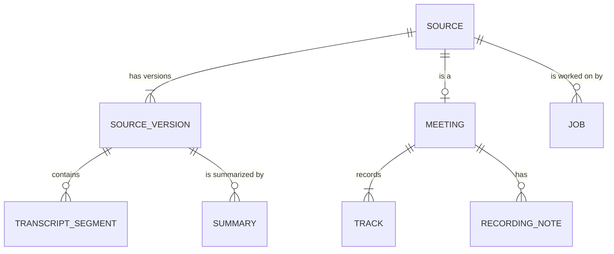

# Data model

How Trama stores what the user records and writes. This document covers **phase 1** of
the [MVP](../vision.md#mvp) in full and says where the later layers of the
[knowledge model](../vision.md#knowledge-model) attach. It follows principles
[A2](../principles.md#a2--one-owner-of-the-data) and
[A3](../principles.md#a3--the-data-model-is-designed-up-front),
[ADR 0004](../adr/0004-layered-knowledge-model.md) and [ADR 0007](../adr/0007-tech-stack.md).

## The library

All of a user's data lives in one folder, the **library**:

```
Library/
├── trama.db          SQLite database (with trama.db-wal and trama.db-shm while open)
├── trama.lock        held by the process that owns the library
└── audio/
    └── <meeting id>/ the audio tracks and timing files of one meeting
```

- **Default location**: `~/Library/Application Support/io.github.lorenzotricaricoo.trama/Library`.
  It is outside `~/Documents` on purpose: folders synced by iCloud can corrupt an open
  SQLite database. Time Machine backs it up.
- **Moving the library** (with the [settings](https://github.com/lorenzotricaricoo/Trama/issues/36)):
  the location is stored in a small configuration file next to the default location,
  never inside the database, so the app can find the library before opening it.
- **One owner** ([A2](../principles.md#a2--one-owner-of-the-data)): opening a library takes
  an exclusive lock on `trama.lock`. A second process (a second copy of the app, a
  CLI opening the file directly) is refused; the MCP server and the CLI go through the
  owner's API.
- **Backup**: the core can write a consistent copy of the database while the app runs
  (`VACUUM INTO`). Copying the folder by hand is safe with the app closed.
- **Paths** to audio files are stored relative to the library, so the folder can be
  moved or restored elsewhere.

## Principles of the model

- **Sources are immutable.** What the user recorded or wrote is kept as it was. A change
  creates a new **version**; old versions are never rewritten. Everything Trama derives
  later (summaries, index, entities, wiki pages) points to a specific version, so a
  citation keeps pointing at the text it was made from.
- **Derived data can be rebuilt.** The search index is maintained by the database
  itself and can be rebuilt from the sources; summaries can be generated again.
- **Identifiers** are [UUIDv7](https://www.rfc-editor.org/rfc/rfc9562#name-uuid-version-7),
  stored as text. They are unique without coordination (export, import, a future sync)
  and sort by creation time. Transcript segments, which are numerous and never change,
  use an integer key that is stable once written.
- **Timestamps** are UTC milliseconds since the Unix epoch (`INTEGER`). Times *inside* a
  meeting (a segment, a note pinned to a minute) are milliseconds from the start of the
  recording. Formatting is the interface's job ([A5](../principles.md#a5--foundations-from-day-one)).
- **Text** is stored as the user or the engine produced it. Search ignores case and
  accents.
- **Deleting** moves a source to the **trash** for 30 days; after that it is removed
  for good, with its audio.

## Entities



### Source

A meeting or a note (documents arrive in phase 3 as a new kind).

| Field | Meaning |
|-------|---------|
| `id` | UUIDv7 |
| `kind` | `meeting` or `note` |
| `title` | Shown everywhere; empty until a summary or the user gives one |
| `title_origin` | `auto` (from the summary) or `user`. A user title is never overwritten |
| `language` | Language of a meeting (BCP 47, for example `it`), chosen in onboarding; it also decides the language of the summary. Empty for notes |
| `occurred_at` | When the meeting started, or when the note was created |
| `created_at`, `updated_at` | Bookkeeping |
| `deleted_at` | Set while the source is in the trash |

### Source version

One state of a source's content. The **current version** is the one with the highest
number.

| Field | Meaning |
|-------|---------|
| `id` | UUIDv7; what derived data points to |
| `source_id`, `number` | Versions are numbered 1, 2, … per source |
| `origin` | `transcription` (a meeting transcribed by an engine) or `editor` (a note) |
| `engine` | The transcription engine and model, for example `parakeet-ultra-fp32` |
| `body` | The text of a note (Markdown). Empty for transcriptions, whose text is in segments |
| `created_at`, `edited_at` | When the version was started and last changed |
| `sealed_at` | Once set, the version and its segments can no longer change |

**Meetings** get a sealed version for each transcription: the first one after the
recording, another one if the user transcribes it again with a better engine while
the audio still exists.

**Notes** are saved automatically while the user types. Saving every keystroke as a
version would bury the history, so a note has at most one **open** version, updated in
place, which is **sealed** when either:

- the user starts typing again after a pause of **10 minutes** or more (the new text
  starts a new version), or
- the curator (phase 2) reads the note, so what it cites can no longer change.

The database refuses changes to a sealed version.

### Meeting

The recording side of a meeting source.

| Field | Meaning |
|-------|---------|
| `source_id` | The source it belongs to |
| `status` | `recording`, `processing` (transcription and summary), `ready` or `failed` |
| `duration_ms` | Length of the recording |
| `audio_deleted_at` | When the audio was removed by the retention rule; empty while it exists |
| `error_code` | Why the meeting failed, as a code the interface translates; for example `recording_interrupted` when the app stopped during a recording |

### Track

One audio track of a meeting: the user's microphone and the other participants
(system audio), recorded separately ([spike #11](https://github.com/lorenzotricaricoo/Trama/issues/11)).

| Field | Meaning |
|-------|---------|
| `id` | UUIDv7 |
| `meeting_id` | The meeting |
| `role` | `me` or `others`; one track per role |
| `audio_path` | Relative to the library, for example `audio/<meeting id>/me.wav` |
| `timing_path` | Optional file that aligns the two tracks ([timing sidecar](audio-capture.md#timing-sidecar)) |
| `device` | Name of the input device, for diagnostics |

### Transcript segment

A stretch of speech in a transcription version.

| Field | Meaning |
|-------|---------|
| `id` | Integer, stable once written |
| `version_id` | The transcription version |
| `seq` | Order within the version |
| `role` | `me` or `others`: who spoke, from the track it came from |
| `start_ms`, `end_ms` | Position in the recording |
| `text` | The words |

### Recording note

A note the user types while recording, pinned to a minute of the meeting. These notes
are the user's annotations rather than part of the recording, so they stay **editable**
after the meeting; they are not versioned.

| Field | Meaning |
|-------|---------|
| `id` | UUIDv7 |
| `meeting_id` | The meeting |
| `at_ms` | Position in the recording |
| `text` | The note |
| `created_at`, `updated_at` | Bookkeeping |

### Summary

The title, summary and key points generated for a version. Generating again (another
model, a better prompt) adds a summary; the newest one is shown.

| Field | Meaning |
|-------|---------|
| `id` | UUIDv7 |
| `version_id` | The version that was summarized |
| `title`, `body`, `key_points` | Generated content; key points are a JSON array of strings |
| `language` | Language it was written in (the meeting language) |
| `model`, `prompt_version` | What produced it, to compare and regenerate |
| `created_at` | When it was generated |

### Settings

A key/value table for preferences that belong to the library: meeting language, audio
retention, and so on. Each key is documented where it is used. Secrets are never stored
here: provider keys live in the macOS Keychain and the database keeps only a reference.

### Job

Background work on a source: transcription, summary, removal of audio. Jobs are stored,
so they survive a restart, and run one at a time.

| Field | Meaning |
|-------|---------|
| `id` | UUIDv7 |
| `kind` | `transcribe`, `summarize` or `delete_audio` |
| `target_id` | The source the job works on |
| `state` | `queued`, `running`, `done`, `failed` or `cancelled`. At most one queued or running job of each kind per source |
| `attempts`, `max_attempts` | Attempts started so far, and the limit (5) |
| `run_after` | A queued job doesn't start before this time |
| `error_code`, `error_detail` | The last error: a code the interface translates, and technical detail for diagnostics |
| `created_at`, `updated_at`, `finished_at` | Bookkeeping |

- A **retryable** error (a busy resource, a network error) puts the job back in the
  queue after 30 seconds, doubling at each attempt up to one hour; after the last
  attempt, or on a permanent error, the job is `failed` and the interface shows why
  ([A4](../principles.md#a4--llm-calls-are-robust-from-day-one)). The user can retry it.
- **Quitting the app** stops the running job and leaves it in the queue, without
  counting the attempt; it resumes at the next start in the same place.
- **After a crash**, opening the library puts running jobs back in the queue (or marks
  them `failed` with `interrupted` if that was their last attempt) and marks meetings
  that were recording as failed with `recording_interrupted`.
- Jobs on a source in the trash wait until it is restored, and are removed with it.
- Progress (for example "transcribing 62%") is not stored: the core sends it to the
  interface as an event, together with every state change.

### Coming with later phase 1 issues

| Table | What it holds | Issue |
|-------|---------------|-------|
| `provider`, `provider_model`, `task_model` | AI providers (with a Keychain reference, never the key), their model catalogue with limits ([A4](../principles.md#a4--llm-calls-are-robust-from-day-one)), and which model each task uses | [#28](https://github.com/lorenzotricaricoo/Trama/issues/28) |

## Search

A full-text index (SQLite FTS5) covers transcript segments, note bodies and recording
notes. It is kept up to date by the database itself, through triggers, so nothing can
forget to update it.

- The tokenizer ignores case and accents (`unicode61 remove_diacritics 2`): `perche`
  finds `perché`.
- Each word typed is matched as a prefix, so results appear while typing.
- Only the **current version** of each source is searched, and sources in the trash are
  left out.
- Each result points to the source and to the exact segment, note or recording note,
  with a highlighted excerpt.

Search by meaning (vectors with sqlite-vec) arrives with the curator in phase 2 and
records the embedding model of each vector ([ADR 0003](../adr/0003-hybrid-ai-providers.md)).

## Trash and audio

- **Trash**: a deleted source disappears from lists and search and can be restored for
  30 days. After that it is removed with its versions, segments, summaries, notes and
  tracks; the core returns the audio files to delete.
- **Audio retention** ([information architecture](../design/information-architecture.md#audio-retention)):
  the audio of a meeting is removed according to the setting, and `audio_deleted_at`
  records it. The transcript is the source, so removing audio loses nothing the curator
  needs. When the user changes the setting, it also applies to existing meetings, after
  a confirmation that says how many recordings will be removed.

## Schema changes

The schema is created and changed by **migrations**: numbered SQL scripts embedded in
the core and applied in order, each in a transaction, when the library is opened. The
database records the last one applied (`PRAGMA user_version`).

- A library written by a newer version of Trama is refused rather than damaged.
- Tests run every migration on a fresh database and upgrade an older one.
- Foreign keys are enforced; a migration that breaks them fails.

## How phase 2 attaches

Phase 2 adds the layers above the sources ([ADR 0004](../adr/0004-layered-knowledge-model.md))
without changing the tables above:

- **Index**: text chunks with embeddings, each pointing to a source version (and to the
  segments it covers).
- **Entities and relations**: projects, people, decisions, actions, requirements, open
  questions and terms, each with **evidence** that points to a source version and to a
  segment, a stretch of note text or a recording note.
- **Changes**: every change made by the curator, with its confidence, the source
  version that caused it, and what is needed to undo it. Uncertain changes become
  **doubts**.
- **Wiki pages**: one per project, person and topic, versioned like sources, each
  statement citing entities and source versions.

Because derived data points to versions, the curator can process a phase 1 source
again (after a new transcription, or with a better model) and compare its results with
the previous ones.
