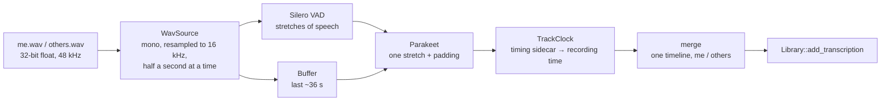

# Transcription

How a recorded meeting becomes a transcript: both tracks transcribed on the device and
merged into one timeline. The engine was chosen by spike
[#10](https://github.com/lorenzotricaricoo/Trama/issues/10) and
[ADR 0007](../adr/0007-tech-stack.md); the code is in `crates/core/src/transcription/`
and `crates/core/src/jobs/transcribe.rs`
([#26](https://github.com/lorenzotricaricoo/Trama/issues/26)).

## Engine

| Part | Choice |
|------|--------|
| Runtime | `sherpa-onnx` 2.0.3 (Rust crate), ONNX Runtime linked statically, CPU, 4 threads |
| Model | Parakeet Ultra, **fp32** export (`parakeet-tdt-0.6b-ultra-fp32`), greedy decoding |
| Voice activity | Silero VAD: threshold 0.5, **1.0 s** minimum silence, 0.25 s minimum speech, **30 s** maximum segment |
| Padding | **500 ms** of audio on each side of a stretch of speech when it is decoded |

The model files come from the models folder the app downloads into
([downloaded models](models.md)); the engine checks that the model is `ready` (verified)
before loading it, and fails with `model_missing` or `model_corrupt` otherwise. The model
is loaded for each transcription and dropped afterwards, so its memory is held only while
a meeting is being transcribed.

### Language

The meeting language is chosen once, in onboarding, and stored with each meeting
(`source.language`, see the [data model](data-model.md)). The model needs no language
setting: it recognizes the language as it decodes, so English terms in an Italian meeting
come out as spoken. The meeting language must be one of the model's 25 European
languages (`transcription::SUPPORTED_LANGUAGES`, matched on the primary subtag, so
`en-GB` is English); otherwise the transcription fails with `language_unsupported`
instead of producing nonsense.

## Pipeline



1. **Read.** `WavSource` reads a track half a second at a time, averages its channels and
   resamples it to 16 kHz (sherpa-onnx's resampler). Integer PCM is read too. An hour of
   audio is never in memory at once.
2. **Detect.** The detector receives every sample and reports stretches of speech, as
   sample positions in the track.
3. **Decode.** Each stretch is decoded with 500 ms of padding from a buffer that keeps
   only the last 36 seconds or so (plus whatever stretches are still waiting). Decoding
   windows never overlap, so no word is decoded twice: a window ends where the next
   stretch starts and starts where the previous window ended. This matters when speech
   longer than 30 s is split at a short pause: without it, the padding of both halves
   would cover the same words. To know where the next stretch starts, a stretch waits
   until the next one is found, the track ends, or the detector has been out of speech
   for longer than the padding plus the time it needs to notice new speech. Stretches
   whose text is empty (noise the detector let through) are dropped.
4. **Place.** A segment's start and end (without the padding) are mapped to the meeting's
   time line through the track's clock (below), in milliseconds.
5. **Merge.** The segments of both tracks are sorted by start time (then end time, `me`
   first at the same instant) and stored as a new sealed transcription version, one
   transcript segment per stretch, labelled `me` or `others`.

### Placing the tracks in time

The recorder ([audio capture](https://github.com/lorenzotricaricoo/Trama/issues/25))
writes a timing sidecar next to each track: JSON Lines whose `start` line gives the
track's sample rate and the host time the recording started at, and whose `anchor` and
`stop` lines pair a frame of the file with the host time it was captured at. Mapping
frames through the anchors removes the late start of the system track, gaps, and clock
drift between devices.

Transcription uses this through a small trait, `TrackClock`:

- `SidecarClock` reads the documented sidecar format (start, anchors, stop; a torn last
  line from a crash is ignored) and interpolates between anchors.
- `NominalClock` places a track at its nominal sample rate from the start of the
  recording. It is used for a track without a sidecar, and for a sidecar that can't be
  read: the realignment is lost, not the transcript, and the problem is logged.

When the recorder's own `Timeline` type is in the core, it can implement `TrackClock`
and replace `SidecarClock`.

## The background job

`jobs::Transcribe` runs `transcribe` jobs on the [job queue](data-model.md): one job at a
time (the runner has one worker), with progress reported through the job events and
weighted by the length of each track. The desktop shell registers it in `start_core`,
with the same models folder the model manager uses (`TRAMA_MODELS` in development).

| Situation | Job | Meeting |
|-----------|-----|---------|
| Running | `running`, progress 0–1 | `processing` |
| Done | `done` | `ready`, with a new transcription version |
| No model (`model_missing`, `model_corrupt`) | `failed` at once | `failed` with that code; download the model, then retry the job |
| Audio gone (`audio_missing`), unreadable (`audio_invalid`), no tracks (`no_audio`), `language_unsupported` | `failed` at once | `failed` with that code |
| Temporary failure (`model_load_failed`, `audio_read_failed`, `recognition_failed`, `storage`) | queued again with a growing delay, up to 5 attempts | stays `processing`; `failed` with the code after the last attempt |
| Meeting still recording (`still_recording`) | queued again | unchanged |
| Cancelled by the user | `cancelled` | `failed` with `transcription_cancelled` |
| The app stops | back in the queue, attempt not counted | stays `processing`; the job runs again at the next start |

Codes are in `transcription::error_code`; the interface translates them (principle A5).
The handler checks for a stop request between chunks of audio and between stretches, so
a cancellation takes effect within about a second.

### Memory

The fp32 model peaks at about 2.8 GB of memory (spike #10). Every transcription samples
the resident memory of the process every 200 ms (`MemoryMonitor`) and logs it with the
speed when it finishes:

```
trama: transcribed meeting 0193…: 42 segments, 3600 s of audio in 160 s (22.5x real time), peak memory 2.85 GB
```

Measured on the FLEURS check below (M3 Pro): see the pull request of #26 for the numbers
of the latest run.

## Native libraries

`sherpa-onnx-sys` downloads a prebuilt archive of sherpa-onnx and ONNX Runtime from the
sherpa-onnx GitHub release when it is built, and links it statically. It does not check
what it downloads, so the core verifies it (ADR 0007):

- `sherpa-onnx` and `sherpa-onnx-sys` are pinned to `=2.0.3` in `crates/core/Cargo.toml`
  (and `Cargo.lock`).
- `crates/core/build.rs` holds the SHA-256 of the static archive for each supported
  target (macOS arm64 and x86-64, Windows x64 and arm64, Linux x64 and arm64), taken
  from the `digest` that GitHub publishes for each release asset.
- The core depends on `sherpa-onnx-sys` directly, so Cargo runs its build script first
  (it has a `links` key). The core's build script then hashes the archive in
  `target/sherpa-onnx-prebuilt/` and **stops the build** if it doesn't match, before
  anything is linked.
- Offline builds: put the archive in a folder and set `SHERPA_ONNX_ARCHIVE_DIR`; it is
  copied into the same cache and verified the same way. `SHERPA_ONNX_LIB_DIR` (libraries
  built by hand) skips the check, with a build warning.
- Upgrading sherpa-onnx means changing both pins and the checksums together:
  `gh api repos/k2-fsa/sherpa-onnx/releases/tags/v<version> --jq '.assets[] | "\(.digest) \(.name)"'`.

A failed check names the archive and says to delete `target/sherpa-onnx-prebuilt/` and
build again. CI (`macos-latest`) builds the same way, without the model.

## Tests

Fast tests run everywhere, without the model (`crates/core/tests/transcription.rs` and
the unit tests in `src/transcription/`). They use a fake detector and a fake recognizer
on synthetic tones (the recognizer "reads" each tone as a word chosen by its pitch), and
cover: stretches and padding, splitting of long speech without decoding audio twice,
silence (no decoding at all), stopping, progress, WAV reading and resampling, the
sidecar clock (late start, drift, torn line), merging two tracks, the real loader without
a model, and the job: success, missing model, temporary failures, deleted audio,
unsupported language, a meeting still recording, cancellation.

Tests with the real model are `#[ignore]`d (`crates/core/tests/transcription_model.rs`):

```sh
TRAMA_MODELS=/path/to/models cargo test --release -p trama-core \
    --test transcription_model -- --ignored --nocapture --test-threads=1
```

- **FLEURS check:** the first 200 utterances of the Italian test split of
  [FLEURS](https://huggingface.co/datasets/google/fleurs) (CC-BY-4.0, 47.8 minutes, the
  set spike #10 measured), scored with the spike's normalization (NFKC, lowercase,
  punctuation to spaces, accents kept, numbers not spelled out). The word error rate
  must stay at or below **2.5%**. The test downloads the audio archive (658 MB, pinned
  to a commit, SHA-256 verified) once and keeps only the clips it needs in
  `target/fixtures` (`TRAMA_FIXTURES` to change it); nothing is committed.
  `TRAMA_FLEURS_CLIPS` changes the number of clips.
- **Silence:** a minute each of digital silence, white noise and room tone at several
  levels must produce **no words**.
- **A recorded meeting:** two 48 kHz float tracks built from FLEURS clips, the system
  track starting 3 s late with its sidecar, transcribed by the real job: the meeting ends
  `ready`, the turns alternate `me`, `others`, `me` at the right times, with the right
  text.

The maintainer's own recordings are never used as fixtures.

## Licenses

The model weights are CC-BY-4.0 and the FLEURS audio used by the tests is CC-BY-4.0;
see [THIRD_PARTY_NOTICES.md](../../THIRD_PARTY_NOTICES.md) for the attributions.
